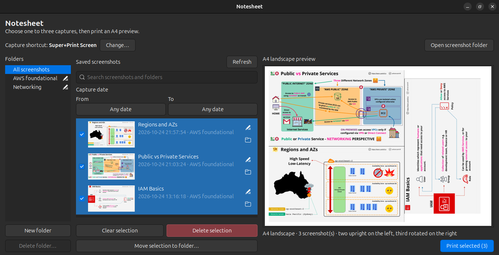
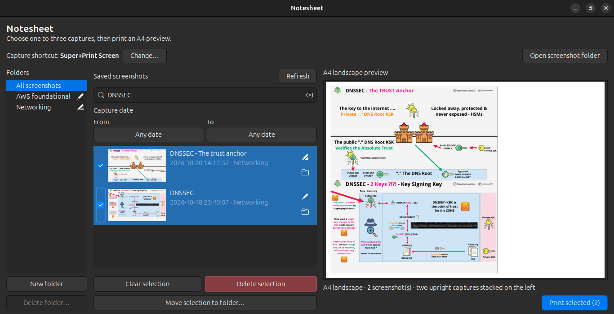
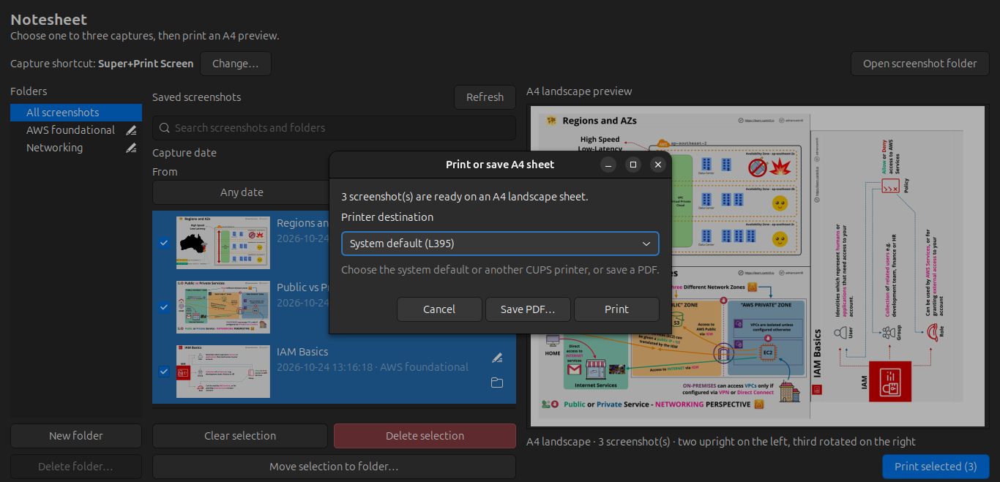
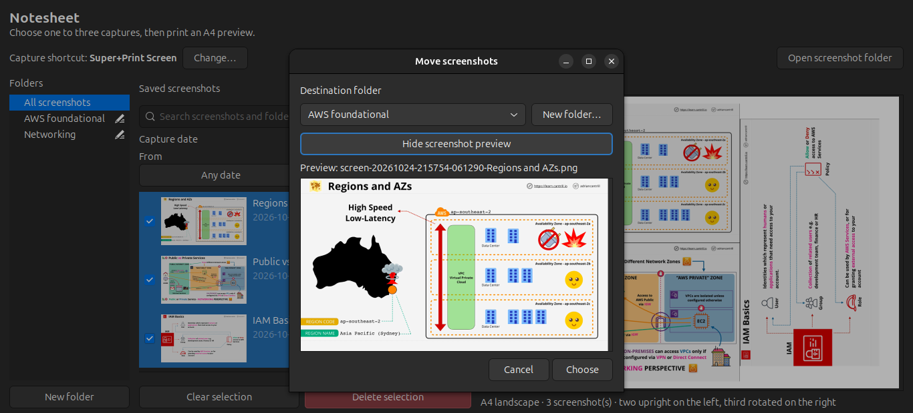
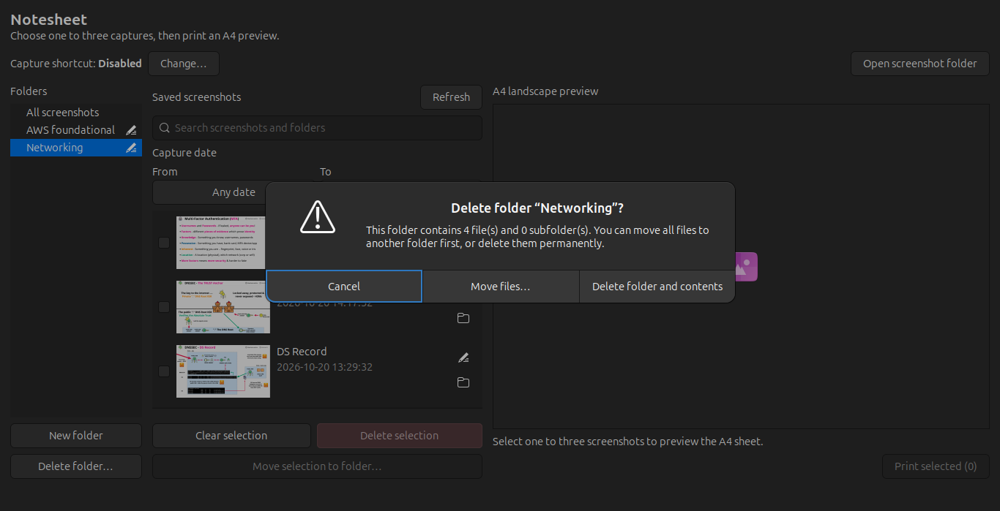
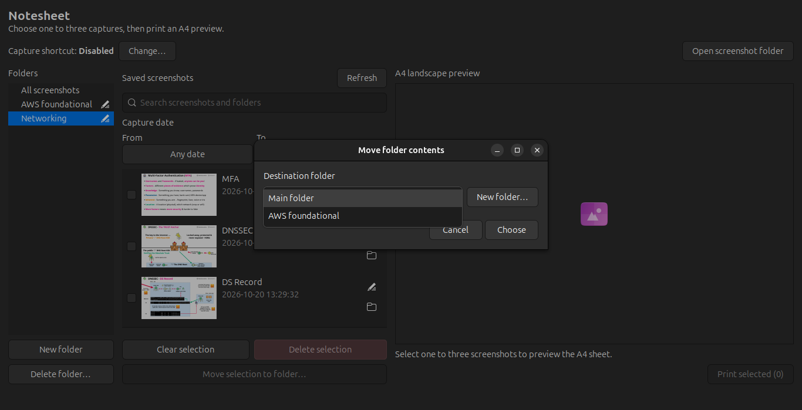

# Notesheet

Notesheet captures full-screen images, lets you select up to three, previews their layout on landscape A4, and prints through CUPS or saves a PDF. The order in which you select captures determines their positions on the page.

## Screenshots

The screenshots show the current folder library, search results, A4 preview and print options, plus the safe move-before-delete flow for folders with files.













## Install and run

On Ubuntu, install the runtime dependencies:

```bash
sudo apt install python3-gi gir1.2-gtk-3.0 python3-pil cups-client xdg-user-dirs libnotify-bin zenity
```

Clone the repository, then launch the interface:

```bash
git clone https://github.com/nehuencabibbo/notesheet.git
cd notesheet
python3 notesheet.py ui
```

To assign the default **Alt+Print** capture shortcut, run:

```bash
python3 notesheet.py setup-shortcut
```

The current shortcut appears in bold in the toolbar. Use **Change…** to choose a different combination. Press Escape to cancel. Run `python3 notesheet.py remove-shortcut` to restore GNOME’s previous window-screenshot shortcut.

Each capture opens a save dialog where you can choose a folder or create one. Enter an optional name, or leave it blank to use `screen-YYYYMMDD-HHMMSS-microseconds.png`. **Cancel capture** discards the screenshot. The saved confirmation uses urgent notification priority so GNOME can show it over fullscreen video.

## Use the app

- Captures are saved under `~/Pictures/NoteCaptures/Captures/`. The folder list shows **All screenshots** and each top-level folder alongside it; subfolders appear under their parent. Folders are kept in alphabetical order. Selecting a folder shows screenshots stored directly inside it.
- Use **New folder** to create a subfolder inside the selected folder, or a top-level folder when **All screenshots** is selected. Creating a folder keeps the current folder selected. New screenshots can be saved to any existing folder or subfolder from the capture dialog, which also lets you create a folder without changing the selected destination. The last selected save folder is remembered.
- Click the pencil icon at the right of a folder row to rename it; its subfolders, screenshots, and saved references are kept. Drag a folder onto another folder to move it inside; the destination name is highlighted while you drag. When deleting a folder with files, choose **Move files…** to put them in the main folder or another folder before removing it, or delete the contents permanently. Empty folders have a simple delete confirmation.
- Screenshots are listed newest to oldest, with the capture timestamp below each name. In **All screenshots**, each row also shows its current folder. Use the search field to filter by custom name, file name, or folder path. Use the rename button to change a screenshot's name; leave the name blank to use its capture timestamp. The rename, move, and save dialogs can show a preview of the screenshot.
- Use the **From** and **To** calendar pickers to filter by an inclusive date range. Leave either limit empty for an open-ended range, or choose the same date in both pickers to show one day. Use **Clear** to show all dates again.
- Select one to three screenshots by clicking their checkbox or the thumbnail and details area. Selected screenshots stay highlighted in blue with their checkboxes marked and remain visible regardless of the selected folder, search, or date filters. When a filter is active, selected screenshots appear at the top in selection order. Their selection order determines their positions on the page.
- Use the folder button under the rename button to move one screenshot, or drag a screenshot onto a folder. **Move selection to folder…** also moves several selected screenshots at once. The destination chooser can create a new folder.
- The A4 landscape preview updates as the selection changes. **Print selected** offers the system default printer, other CUPS queues, and **Save PDF…**. Created sheets are also kept under `~/Pictures/NoteCaptures/Sheets/`.
- Screenshots remain in the library after printing. **Delete selection** removes all checked screenshots after confirmation.

The layouts are:

1. One screenshot centered on the page.
2. Two upright screenshots stacked on the left.
3. Two upright screenshots on the left and the third rotated on the right.

## Terminal commands

```bash
python3 notesheet.py status
python3 notesheet.py open-latest
python3 notesheet.py print-latest
python3 notesheet.py remove-shortcut
```

`status` lists the capture count and latest sheet. `open-latest` opens the latest PDF. `print-latest` sends it to the system default CUPS printer. Use `lpstat -e` and `lpstat -d` to list installed printers and check the default.

## Page layout

The page is A4 landscape at 300 dpi, with 5 mm margins and no gaps between screenshots. Thin black cut guides appear only where screenshots touch. Each screenshot keeps its aspect ratio and targets up to 180 mm wide. A 16:9 desktop image fits at about 176 × 99 mm in the three-capture layout.
