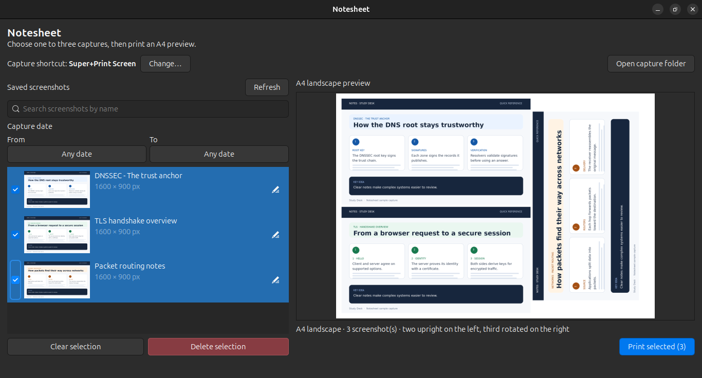
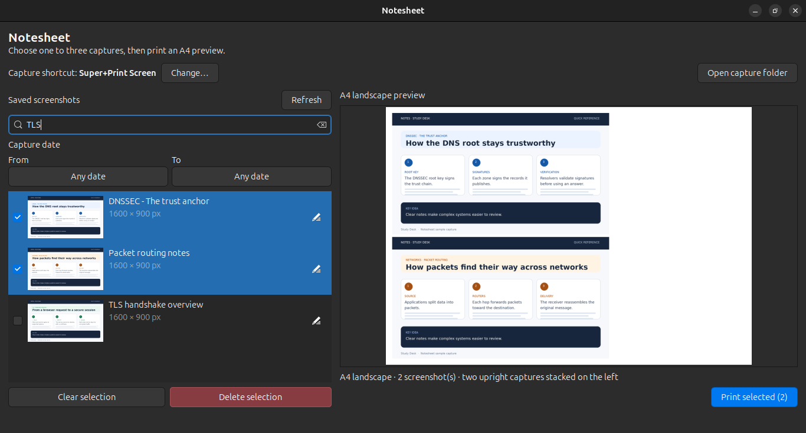
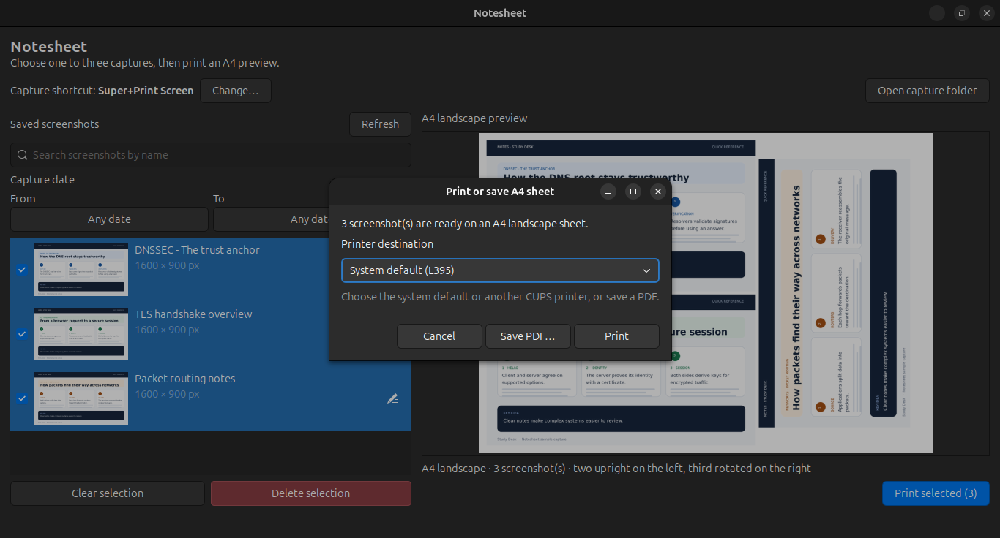

# Notesheet

Notesheet captures full-screen images, lets you select up to three, previews their layout on landscape A4, and prints through CUPS or saves a PDF. The order in which you select captures determines their positions on the page.

## Screenshots

The screenshots show the current library and A4 preview, selected captures alongside search results, and the printer or PDF destination dialog.







## Install and run

On Ubuntu, install the runtime dependencies:

```bash
sudo apt install python3-gi gir1.2-gtk-3.0 python3-pil cups-client xdg-user-dirs libnotify-bin zenity
```

Clone the repository, then launch the interface:

```bash
git clone https://github.com/nehuencabibbo/notesheet.git
cd notesheet
python3 notesheet.py ui
```

To assign the default **Alt+Print** capture shortcut, run:

```bash
python3 notesheet.py setup-shortcut
```

The current shortcut appears in bold in the toolbar. Use **Change…** to choose a different combination. Press Escape to cancel. Run `python3 notesheet.py remove-shortcut` to restore GNOME’s previous window-screenshot shortcut.

Each capture opens a save dialog before writing the image. Enter an optional name, or leave it blank to use `screen-YYYYMMDD-HHMMSS-microseconds.png` (for example, `screen-20261020-132932-359695.png`). **Cancel capture** discards the screenshot. The saved confirmation uses urgent notification priority so GNOME can show it over fullscreen video.

## Use the app

- Captures are saved under `~/Pictures/NoteCaptures/Captures/`.
- Screenshots are listed newest to oldest. Use the search field to filter by custom name or file name. Use the rename icon on a screenshot row to change its name; leave the name blank to use its capture timestamp.
- Use the **From** and **To** calendar pickers to filter by an inclusive date range. Leave either limit empty for an open-ended range, or choose the same date in both pickers to show one day. Use **Clear** to show all dates again.
- Select one to three screenshots by clicking their checkbox or the thumbnail and details area. Selected screenshots stay highlighted in blue with their checkboxes marked and remain visible regardless of active search or date filters. Selecting a screenshot does not move it; when a search or date filter is applied, selected screenshots appear at the top in selection order. Their selection order determines their positions on the page.
- The A4 landscape preview updates as the selection changes. **Print selected** offers the system default printer, other CUPS queues, and **Save PDF…**. Created sheets are also kept under `~/Pictures/NoteCaptures/Sheets/`.
- Screenshots remain in the library after printing. **Delete selection** removes all checked screenshots after confirmation.

The layouts are:

1. One screenshot centered on the page.
2. Two upright screenshots stacked on the left.
3. Two upright screenshots on the left and the third rotated on the right.

## Terminal commands

```bash
python3 notesheet.py status
python3 notesheet.py open-latest
python3 notesheet.py print-latest
python3 notesheet.py remove-shortcut
```

`status` lists the capture count and latest sheet. `open-latest` opens the latest PDF. `print-latest` sends it to the system default CUPS printer. Use `lpstat -e` and `lpstat -d` to list installed printers and check the default.

## Page layout

The page is A4 landscape at 300 dpi, with 5 mm margins and 2 mm gaps. Each screenshot keeps its aspect ratio and targets up to 180 mm wide. A 16:9 desktop image fits at about 176 × 99 mm in the three-capture layout.
